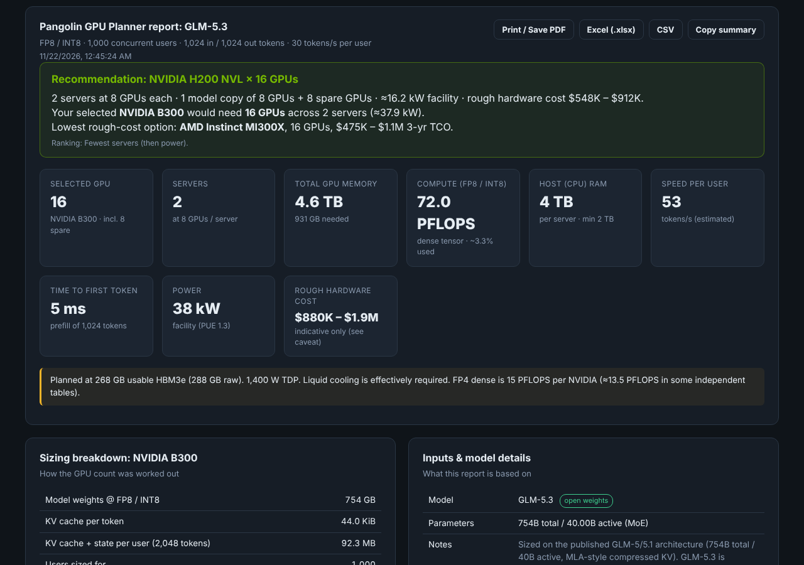

# Pangolin GPU Planner

**AI Inference Capacity & Cost Sizing**: work out how many dedicated GPUs, servers, host RAM and power an LLM inference workload needs. It compares 22 GPU types and gives a rough cost estimate.

[](https://bobroberts2639.github.io/Pangolin-GPU-Capacity-Planner/)
[](https://github.com/bobroberts2639/Pangolin-GPU-Capacity-Planner/actions/workflows/tests.yml)
[](#install-as-an-app-pwa)
[](LICENSE)

<p align="center">
  
</p>

> **Launch:** https://bobroberts2639.github.io/Pangolin-GPU-Capacity-Planner/
>
> 

---

## Contents
- [What it does](#what-it-does)
- [Quick start](#quick-start)
- [Install as an app (PWA)](#install-as-an-app-pwa)
- [Using the planner](#using-the-planner)
- [Python engine & Jupyter notebook](#python-engine--jupyter-notebook)
- [How the sizing works](#how-the-sizing-works)
- [Data model & updating data](#data-model--updating-data)
- [Cost estimates: caveat emptor](#cost-estimates-caveat-emptor)
- [Project structure](#project-structure)
- [Deploying to GitHub Pages](#deploying-to-github-pages)
- [Development & tests](#development--tests)
- [Limitations](#limitations)
- [License](#license)

## What it does

Pick a **model**, **precision** and **workload** (input/output tokens, concurrent users, speed target). The planner then:

- sizes the deployment on **every GPU** and recommends the best one (ranked by fewest servers, lowest power, lowest rough cost or fewest GPUs)
- reports **dedicated GPUs, servers, total GPU memory, TFLOPS (FP16/FP8/FP4/TF32), host (CPU) RAM, CPU cores, power** and a **rough cost range**
- handles **peak load** (1–3×) and **redundancy** (N+1, N+2, +10/20%, 2N)
- **saves scenarios**, **compares** them side by side and builds **multi-workload deployment plans**, including the best single GPU type for the whole plan
- exports to **Excel (.xlsx)**, **CSV** and **PDF** (print), with optional company/project branding
- runs **entirely in the browser**: no server, no sign-up and no data leaves the device. It also works **offline** once installed.

**Coverage:**
- **25 models:** Llama, Mistral, Qwen, Kimi, GLM, DeepSeek, plus estimated sizes for closed GPT, Gemini, Claude, Grok and Muse models.
- **22 GPUs:**
  - NVIDIA Ampere: A10, A30, A40, A100
  - NVIDIA Ada: L4, L40, L40S
  - NVIDIA Hopper: H100 (SXM, PCIe, NVL), H200 (SXM, NVL), H800
  - NVIDIA Blackwell: B100, B200, B300, GB200 NVL72, GB300 NVL72
  - NVIDIA Rubin (preliminary)
  - AMD: MI300X, MI325X, MI355X

## Quick start

| Option | How |
|---|---|
| **Use it online** | Open https://bobroberts2639.github.io/Pangolin-GPU-Capacity-Planner/ or scan the QR code above. |
| **Open locally** | Download or clone the repo and double-click `index.html`. It works from `file://`; only the offline/install features need a web server. |
| **Local web server** | `python -m http.server 8000` in the repo folder, then open http://localhost:8000 |
| **Python / notebook** | `pip install -r requirements.txt`, then `jupyter notebook notebooks/pangolin_gpu_planner.ipynb` |

## Install as an app (PWA)

The planner is a Progressive Web App: it can be installed like a desktop or mobile app and works offline. Installing needs HTTPS, which the GitHub Pages site provides.

- **Chrome / Edge (Windows, macOS, Linux, ChromeOS):** click **Install app** in the planner's header, or use the install icon in the address bar.
- **Android (Chrome):** menu ⋮ → **Install app** / **Add to Home screen**.
- **iPhone / iPad (Safari):** Share → **Add to Home Screen**.

Updates install automatically the next time the app is opened online. Saved scenarios are kept in the browser's local storage on each device. Use **Export scenarios (.json)** to back them up or move them between devices.

## Using the planner

1. **Model & precision.** Choose a model (closed models are flagged and use placeholder sizes) and a precision: FP16/BF16, FP8/INT8, FP4 or FP32. The *Application / purpose* preset fills in typical sequence lengths. You can edit model figures to describe a fine-tune or variant.
2. **Workload.** Set input/output tokens (0–8192), concurrent users (1–100,000), target tokens/s per user and a peak load factor.
3. **Infrastructure.** Choose the GPU, max memory utilisation, GPUs per server, redundancy and how to rank the options.
4. **Cost assumptions** *(optional, rough)*. Set the electricity price, ownership period, utilisation, maintenance rate and the selected GPU's price range.
5. **Generate report.** It shows the recommendation, KPIs, warnings, sizing breakdown, hardware spec (bill of materials), rough cost, a comparison of all GPUs, and the method.
6. **Save as scenario.** Save one scenario per workload. Then use **Compare selected** or **Build plan from selected**.
7. **Export.** Excel, CSV, Print / Save PDF, or Copy summary.

## Python engine & Jupyter notebook

`python/pangolin_planner.py` is a line-by-line port of the web app's engine. It reads the **same** `js/data.js`, and the two were verified to give identical results on 60 random scenarios across all 22 GPUs. It uses the same input format as the web app, so scenarios exported from the browser load directly:

```python
import sys; sys.path.insert(0, "python")
import pangolin_planner as pp

inp = pp.default_inputs(model="glm53", prec="FP8", users=1000, tps=30, gpu="b300", gps=8, redund="n1")
R = pp.compute_all(inp)
print(R["best"]["gpu"]["name"], R["best"]["gpus"])
pp.comparison_table(R)                                   # pandas DataFrame, all GPUs
pp.sweep(inp, "users", [100, 1000, 10000], gpus=["h200", "b300"])
pp.plan(pp.load_scenarios("pangolin-gpu-planner-scenarios.json"))   # from the web app
```

Command line: `python python/pangolin_planner.py llama31-8b h100 500`

The notebook [`notebooks/pangolin_gpu_planner.ipynb`](notebooks/pangolin_gpu_planner.ipynb) walks through the data tables, single sizing, GPU comparison charts, user-count and precision sweeps, a multi-workload plan, cost sensitivity and Excel export.

## How the sizing works

| Step | Rule |
|---|---|
| Weights | total parameters × bytes/param (FP32 4, FP16 2, FP8 1, FP4 0.5). MoE models keep **all** experts in memory. |
| KV cache | KV/token × (input + output tokens) × users, plus any fixed per-user state for linear-attention models (Kimi K3.x, Qwen 3.8). FP4 runs use an FP8 KV cache. +10% runtime overhead. |
| Copy size | Smallest power-of-two tensor-parallel group that holds the weights, widened if needed to reach the speed target. Larger groups are also tried and the cheapest total is kept. |
| Replicas | Add copies until memory, per-user speed (bandwidth-bound decode at 70% of HBM bandwidth) and compute (40% of dense TFLOPS) are all satisfied. |
| Peak / redundancy | Users × peak factor; then spare GPUs (N+1 = one server's worth, rounded to whole copies). |
| GPUs per server | Capped at 8 for PCIe/SXM/OAM servers and 72 for NVL72 racks. |
| Host RAM | Minimum ≈0.85×, recommended 2× GPU memory per server (capped at 4 TB per 8 GPUs). NVL72 uses Grace/Vera LPDDR5X. |
| Power | GPU TDP × count, +30% host/network, × PUE 1.3 |
| Time to first token | 2 × active params × input tokens ÷ (copy TFLOPS × 50%) |

All constants live in `js/data.js` → `constants`. Not modelled: prefix caching, speculative decoding, disaggregated prefill/decode, multi-LoRA and queueing. Treat results as planning estimates and validate them with vendor benchmarks or a pilot.

## Data model & updating data

**`js/data.js` is the single source of truth** for the web app, Python engine, notebook and tests. Everything after `window.PLANNER_DATA =` must remain **strict JSON**.

| Section | Fields |
|---|---|
| `models[]` | `id`, `name`, `total`, `active` (billions), `kv` (KiB/token at FP16), `state` (MB/user), `open`, `est` (placeholder size), `stateEst`, `kvEst`, `note` |
| `gpus[]` | `id`, `name`, `vendor`, `arch`, `form` (PCIe/SXM/OAM/NVL72), `mem` (usable GB), `memRaw`, `bw` (GB/s), `fp16`/`fp8`/`fp4`/`fp32` (dense TFLOPS; `fp4: 0` = no native FP4; `fp32` = TF32), `tdp` (W), `fp8native`, `price` [low, high] USD, `prelim`, `note` |
| `constants` | efficiencies, overheads, PUE, host RAM ratios, cost factors |
| `serverBaseCostPer8` | server cost excluding GPUs, per 8 GPU slots, by form factor |

To add a GPU or model, add one line to the array, bump `dataDate`, run `pytest`, and bump `CACHE` in `sw.js` so installed apps refresh. Data was last reviewed **November 2026**. Prices and preliminary specs (Rubin) go out of date fastest.

## Cost estimates: caveat emptor

> ⚠️ **All cost figures are rough indicative ranges for early budgeting and relative comparison only.** GPU, server, network and energy prices change quickly and vary with supplier, volume, contract terms, region, configuration and availability. Figures may be wrong by **±30–50% or more**. They are **not quotes**. Excluded: facility build-out, cooling plant, software licences, staffing, taxes and financing. Always get vendor quotes.

## Project structure

```
├── index.html               Web app (open directly or serve)
├── css/styles.css           Styles (screen + print)
├── js/data.js               ★ Models, GPUs, assumptions (shared with Python)
├── js/app.js                Sizing engine, UI, scenarios, plans, exports
├── manifest.webmanifest     PWA manifest
├── sw.js                    Service worker (offline cache)
├── icons/                   App icons (SVG, PNG, maskable)
├── python/pangolin_planner.py   Python port of the engine
├── notebooks/pangolin_gpu_planner.ipynb
├── tests/test_engine.py     Regression tests (pytest)
├── docs/                    Screenshots, QR codes
├── .github/workflows/       pages.yml (deploy), tests.yml (CI)
├── requirements.txt
├── CHANGELOG.md · CONTRIBUTING.md · LICENSE
```

## Deploying to GitHub Pages

1. Push this folder to the `main` branch of `bobroberts2639/Pangolin-GPU-Capacity-Planner`.
2. Go to **Settings → Pages → Build and deployment → Source: GitHub Actions**.
3. The **Deploy to GitHub Pages** workflow publishes the app to
   `https://bobroberts2639.github.io/Pangolin-GPU-Capacity-Planner/`. The QR codes in `docs/qr/` point there.

(Alternatively choose *Deploy from a branch → main / root*. The `.nojekyll` file makes sure all files are served.)

```bash
git init
git add .
git commit -m "Pangolin GPU Planner v2.0.0"
git branch -M main
git remote add origin https://github.com/bobroberts2639/Pangolin-GPU-Capacity-Planner.git
git push -u origin main
```

## Development & tests

```bash
pip install -r requirements.txt
pytest -q tests                                     # engine regression tests
jupyter nbconvert --execute --to notebook notebooks/pangolin_gpu_planner.ipynb --output /tmp/out.ipynb
python -m http.server 8000                          # test the PWA / offline mode
```

If you change the engine in `js/app.js`, make the same change in `python/pangolin_planner.py` and update the reference values in `tests/test_engine.py`. See [CONTRIBUTING.md](CONTRIBUTING.md).

## Limitations

- Sizes **inference** only, not training or fine-tuning.
- Closed-model sizes (GPT, Gemini, Claude, Grok, Muse Wonder/Ember) are **placeholders**. Those models are API-only and can't normally be self-hosted.
- Throughput is an analytical estimate. Real numbers depend on the serving engine (vLLM, SGLang, TensorRT-LLM), kernels, batching policy and network fabric.
- Rubin figures are preliminary, and the B300 FP4 figure varies by source (13.5–15 PFLOPS dense).

## License

[MIT](LICENSE). Model and product names are trademarks of their respective owners. The project is not affiliated with or endorsed by NVIDIA, AMD or any model provider.
